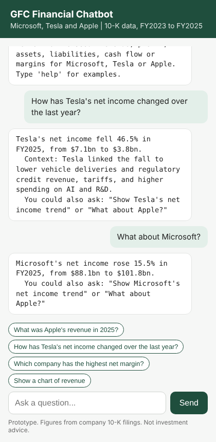

# BCG GenAI Financial Chatbot

An AI-powered financial chatbot built for the **BCG GenAI Job Simulation on Forage**. It analyses 10-K data for Microsoft, Tesla and Apple and answers financial questions in plain English.

**Author:** Gibson Nyendwa, Junior Data Scientist (simulated role), BCG GenAI Consulting team

## The client problem

Global Finance Corp. (GFC) needs to analyse corporate financial performance faster than its traditional methods allow. It asked BCG for an AI-powered chatbot that reads 10-K and 10-Q data and explains it conversationally, built to four requirements: **efficiency, accuracy, a user-friendly interface and scalability**. See the [build log](docs/BUILD_LOG.md#how-the-build-meets-gfcs-requirements) for how each one is met.

## Project status

| Stage | What it covers | Status |
|---|---|---|
| Task 1 | Extract 10-K data and analyse trends in Python | Complete |
| Task 2 | Build and test the financial chatbot | Complete: engine, web app, 37 tests, documentation |

## Repository structure

```
bcg-genai-chatbot/
├── data/
│   ├── financial_data.xlsx                    # Extracted 10-K figures (original spreadsheet)
│   ├── financial_data.csv                     # Raw figures extracted from 10-K filings
│   ├── financial_analysis.csv                 # Data with growth rates and ratios (chatbot input)
│   ├── financial_features_ml.csv              # Adds lag features and encoded company (ML ready)
│   ├── financial_data.json                    # Company > year > metric, for web/API front ends
│   └── BCG_GenAI_Task1_Financial_Analysis.xlsx  # Analysis workbook: raw data, growth, ratios, summary
├── notebooks/
│   ├── 01_financial_analysis.ipynb            # Task 1 analysis
│   ├── BCG_GenAI_Task1_Gibson_Nyendwa.html    # Task 1 notebook exported for Forage submission
│   ├── 02_financial_chatbot.ipynb             # Task 2 chatbot demo, testing and limitations
│   └── BCG_GenAI_Task2_Gibson_Nyendwa.html    # Task 2 notebook exported for Forage submission
├── charts/                                    # Trend charts produced by the notebook
├── chatbot/
│   ├── financial_chatbot.py                   # Task 2 chatbot: v1 predefined queries + v2 rule-based engine, CLI
│   └── app.py                                 # Flask web interface
├── web/
│   ├── chatbot.js                             # Browser copy of the chatbot (verified identical)
│   ├── template.html                          # Test page layout
│   └── gfc_chatbot_demo.html                  # Built test page: chat + 13-check test list
├── tests/
│   └── test_chatbot.py                        # 37 automated tests (pytest)
├── scripts/
│   ├── make_submission.py                     # Builds the Forage Task 2 zip
│   ├── build_web_demo.py                      # Builds the browser test page from the Python code
│   └── parity_test.py                         # Proves browser and Python answers are identical
├── submission/
│   ├── BCG_GenAI_Task2_Gibson_Nyendwa.zip     # Task 2 submission: script, tests, results, docs
│   ├── test_results.txt                       # Latest test run
│   └── demo_conversation.txt                  # Sample conversation
├── docs/
│   ├── Task1_Data_Analysis_Report.md          # Task 1 deliverable: findings and financial health summary
│   ├── CHATBOT_DOCUMENTATION.md               # Task 2 deliverable: how it works, queries, limitations
│   ├── BUILD_LOG.md                           # Step-by-step build process and decisions
│   └── DATA_DICTIONARY.md                     # Column definitions, formulas and data quality rules
└── requirements.txt
```

## Data

- **Source:** Form 10-K filings on SEC EDGAR
- **Companies:** Microsoft, Tesla, Apple
- **Years:** FY2023 to FY2025
- **Metrics:** Total Revenue, Net Income, Total Assets, Total Liabilities, Cash Flow from Operating Activities
- **Units:** US$ millions

## Test the chatbot

There are three ways to check it works, from easiest to most technical.

### 1. In your browser (no install)
Open `web/gfc_chatbot_demo.html` in any browser, or the hosted version of the same page. Chat with the bot on the left, and press **Run all checks** on the right: 13 checks covering values, changes, follow-ups, comparisons, growth rankings, charts, context notes and refusals. **13 / 13 means it is working.**

The web page runs a JavaScript copy of the Python chatbot. `python scripts/parity_test.py` proves both give identical answers to 1,704 questions (requires Node.js).

### 2. In GitHub Codespaces (real Python, no install)
On this repo, click **Code → Codespaces → Create codespace on main**. When the terminal opens:
```bash
pytest -q                          # expect: 37 passed
python -m chatbot.financial_chatbot  # chat in the terminal
python -m chatbot.app              # web app; Codespaces opens a preview link
```

### 3. On your own computer
Needs Python 3.10 or later, then follow **Run it yourself** below.

### What "working" looks like
| Ask | Expected answer contains |
|---|---|
| What was Apple's revenue in 2025? | $416.2bn |
| How has Tesla's net income changed over the last year? | fell 46.5% |
| What about Microsoft? (straight after) | Microsoft's net income rose 15.5% |
| Which company grew revenue fastest? | 1. Microsoft: +15.3% a year |
| Should I buy Tesla shares? | can't give investment advice |
| What is Amazon's revenue? | I don't have data for Amazon |

## Run it yourself

```bash
pip install -r requirements.txt

# Chat with the bot in your terminal
python -m chatbot.financial_chatbot

# Or in your browser (then open http://127.0.0.1:5000)
python -m chatbot.app

# Run the tests
pytest -q

# Open the notebooks
jupyter notebook notebooks/
```

## Example conversation



```
You: How has Tesla's net income changed over the last year?
Bot: Tesla's net income fell 46.5% in FY2025, from $7.1bn to $3.8bn.
  Context: Tesla linked the fall to lower vehicle deliveries and regulatory credit
  revenue, tariffs, and higher spending on AI and R&D.

You: What about Microsoft?
Bot: Microsoft's net income rose 15.5% in FY2025, from $88.1bn to $101.8bn.

You: Which company is least leveraged?
Bot: Liabilities-to-assets ratio in FY2025 (lowest first):
  1. Tesla: 39.9%
  2. Microsoft: 44.5%
  3. Apple: 79.5%

You: What is Amazon's revenue?
Bot: I don't have data for Amazon. I currently cover Microsoft, Tesla and Apple
     for FY2023 to FY2025.
```

## Key findings (Task 1)

- **Microsoft:** strongest performer, with revenue up 15.3% a year, net income up 18.6% a year and the highest margins, while leverage fell each year.
- **Apple:** largest revenue base, with growth returning and record net income of $112.0bn in FY2025 after a one-off tax charge in FY2024.
- **Tesla:** revenue fell in FY2025 and net income dropped from $15.0bn to $3.8bn over two years, though operating cash flow held steady.

Read the full **[Task 1 Data Analysis Report](docs/Task1_Data_Analysis_Report.md)** for findings and a financial health summary, and [`docs/BUILD_LOG.md`](docs/BUILD_LOG.md) for the build process.

## Disclaimer

Created as part of a Forage job simulation. Not an employment relationship with BCG, and not financial advice.
