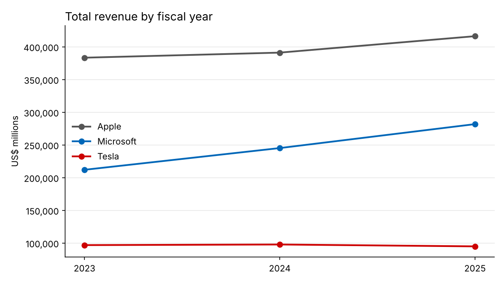
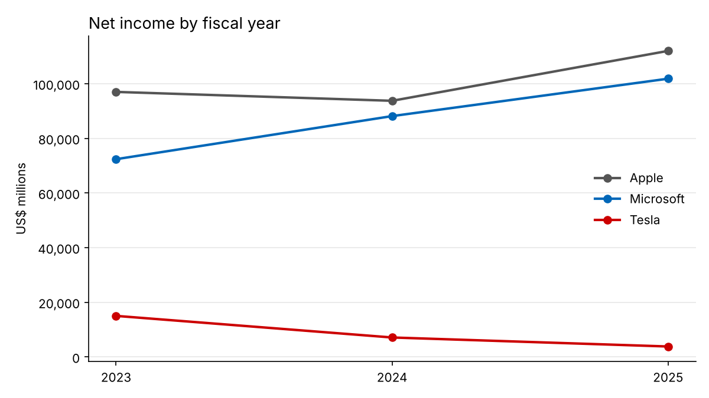
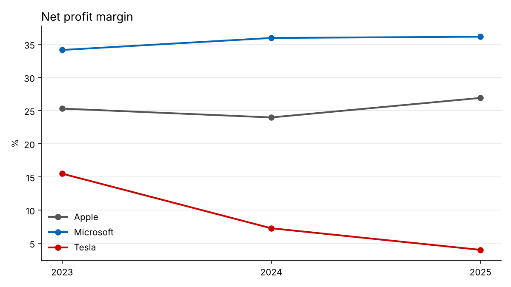
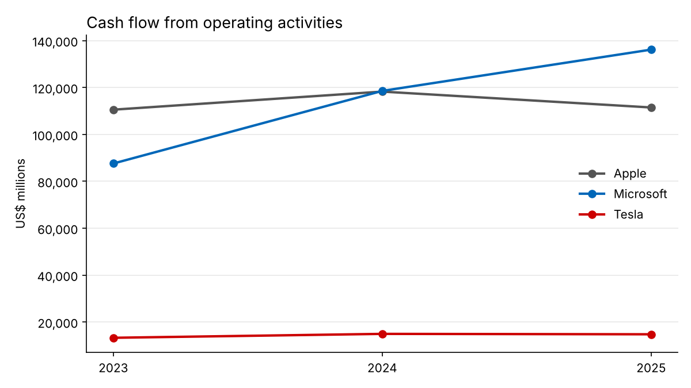

# Financial Data Analysis Report: Microsoft, Tesla and Apple (FY2023 to FY2025)

**Project:** AI-powered financial chatbot for Global Finance Corp. (GFC)
**To:** Aisha, Senior Data Scientist, GenAI Consulting Team
**From:** Gibson Nyendwa, Junior Data Scientist
**Task:** 1 of 2, Data extraction and initial analysis
**Source data:** Form 10-K filings on SEC EDGAR, fiscal years 2023 to 2025 (US$ millions unless stated)

---

## 1. Executive summary

I extracted five core financial metrics from the 10-K filings of Microsoft, Tesla and Apple for fiscal years 2023 to 2025, checked the data for quality, and analysed growth, profitability, leverage and cash generation in Python. The cleaned dataset is ready for the chatbot.

**Financial health at a glance:**

| Company | Overall health | Direction | One-line verdict |
|---|---|---|---|
| **Microsoft** | Strong | Improving | Fastest growth, highest margins and falling leverage |
| **Apple** | Strong | Improving | Growth has returned and net income hit a record $112.0bn in FY2025 |
| **Tesla** | Sound balance sheet, weak profitability | Deteriorating | Revenue fell in FY2025 and net income dropped by three quarters over two years |

**Three findings GFC's clients would care about most:**

1. **Microsoft is the standout performer.** Revenue grew 15.3% a year and net income 18.6% a year, to $101.8bn, while liabilities fell to 44.5% of assets.
2. **Apple's dip was a one-off.** Net income fell 3.4% in FY2024 because of a one-time tax charge of about $10.2bn, then rose 19.5% to a record $112.0bn in FY2025.
3. **Tesla's profit has collapsed, but its cash has not.** Net income fell from $15.0bn to $3.8bn and the margin from 15.5% to 4.0%. Yet operating cash flow held steady at about $14.7bn, nearly four times FY2025 profit.

---

## 2. Scope and method

**Companies:** Microsoft, Tesla and Apple, covering three different business models: software and cloud, electric vehicles and energy, and consumer hardware and services.

**Metrics extracted** (from Item 8, Financial Statements, of each 10-K):

| Metric | Financial statement | Why it matters |
|---|---|---|
| Total Revenue | Income statement | Size and growth of the business |
| Net Income | Income statement | Bottom-line profitability |
| Total Assets | Balance sheet | Scale of resources |
| Total Liabilities | Balance sheet | Obligations and leverage |
| Cash Flow from Operating Activities | Cash flow statement | Whether profit turns into cash |

**Ratios calculated:**
- **Net margin** = Net Income ÷ Total Revenue (profitability)
- **Liabilities to assets** = Total Liabilities ÷ Total Assets (leverage)
- **Operating cash flow to net income** = Operating Cash Flow ÷ Net Income (earnings quality; above 1.0 means profit is backed by cash)
- **Shareholders' equity** = Total Assets − Total Liabilities

**Method:**
1. Figures were extracted manually from each 10-K on SEC EDGAR into an Excel spreadsheet, then cross-checked against company results releases.
2. The spreadsheet was converted to CSV and loaded into pandas.
3. Quality checks ran before any analysis: no missing values, no duplicates, numeric data, three years per company, and liabilities below assets in every row. All checks passed.
4. Year-on-year changes, aggregates by company and by year, ratios and three-year compound annual growth rates (CAGR) were calculated in a Jupyter notebook (`notebooks/01_financial_analysis.ipynb`).

**Fiscal years:** Microsoft's ends on 30 June, Apple's in late September and Tesla's on 31 December. Comparisons are by each company's fiscal year, not calendar year. Tesla's net income is net income attributable to common stockholders.

---

## 3. Findings by company

### 3.1 Microsoft: strong and improving

| Metric | FY2023 | FY2024 | FY2025 | FY2025 change |
|---|---:|---:|---:|---:|
| Total Revenue | 211,915 | 245,122 | 281,724 | +14.9% |
| Net Income | 72,361 | 88,136 | 101,832 | +15.5% |
| Total Assets | 411,976 | 512,163 | 619,003 | +20.9% |
| Total Liabilities | 205,753 | 243,686 | 275,524 | +13.1% |
| Operating Cash Flow | 87,582 | 118,548 | 136,162 | +14.9% |
| Net Margin | 34.1% | 36.0% | 36.1% | |
| Liabilities to Assets | 49.9% | 47.6% | 44.5% | |

- **Consistently fast growth.** Revenue grew about 15% in both years, a three-year CAGR of 15.3%. Net income grew faster still, at 18.6% a year, passing $100bn in FY2025.
- **The highest margins of the three,** rising every year to 36.1%.
- **A larger but safer balance sheet.** Total assets grew 24.3% in FY2024, largely due to the Activision Blizzard acquisition, and a further 20.9% in FY2025. Liabilities grew more slowly, so leverage fell every year.
- **Profit is well backed by cash.** Operating cash flow rose 55% over the period, to $136.2bn, around 1.3 times net income.

**Health assessment:** strong and improving on every dimension measured.

### 3.2 Apple: strong, with growth returning

| Metric | FY2023 | FY2024 | FY2025 | FY2025 change |
|---|---:|---:|---:|---:|
| Total Revenue | 383,285 | 391,035 | 416,161 | +6.4% |
| Net Income | 96,995 | 93,736 | 112,010 | +19.5% |
| Total Assets | 352,583 | 364,980 | 359,241 | −1.6% |
| Total Liabilities | 290,437 | 308,030 | 285,508 | −7.3% |
| Operating Cash Flow | 110,543 | 118,254 | 111,482 | −5.7% |
| Net Margin | 25.3% | 24.0% | 26.9% | |
| Liabilities to Assets | 82.4% | 84.4% | 79.5% | |

- **Growth is accelerating again.** Revenue growth rose from 2.0% in FY2024 to 6.4% in FY2025, taking revenue to $416.2bn, the largest of the three.
- **The FY2024 profit dip was a one-off.** Apple recorded a one-time income tax charge of about $10.2bn linked to the European Commission State Aid decision. Without it, FY2024 net income would have been around $104bn. Net income then reached a record $112.0bn in FY2025, and the margin recovered to 26.9%.
- **High leverage is a deliberate choice.** Liabilities fund about 80% of assets because Apple returns large amounts of cash to shareholders through buybacks and dividends, which keeps equity low. Leverage improved to 79.5% in FY2025 as liabilities fell 7.3%.
- **Cash generation remains huge,** at $111.5bn, though it eased 5.7% and only just matched net income (1.0x) in FY2025.

**Health assessment:** financially very strong, with profit growth back on track.

### 3.3 Tesla: sound balance sheet, sharply weaker profitability

| Metric | FY2023 | FY2024 | FY2025 | FY2025 change |
|---|---:|---:|---:|---:|
| Total Revenue | 96,773 | 97,690 | 94,827 | −2.9% |
| Net Income | 14,997 | 7,091 | 3,794 | −46.5% |
| Total Assets | 106,618 | 122,070 | 137,806 | +12.9% |
| Total Liabilities | 43,009 | 48,390 | 54,941 | +13.5% |
| Operating Cash Flow | 13,256 | 14,923 | 14,747 | −1.2% |
| Net Margin | 15.5% | 7.3% | 4.0% | |
| Liabilities to Assets | 40.3% | 39.6% | 39.9% | |

- **Growth has reversed.** Revenue was flat in FY2024 (+0.9%) and fell 2.9% in FY2025, the only decline among the three companies.
- **Net income fell for two years running,** from $15.0bn to $3.8bn, and the margin fell from 15.5% to 4.0%. Two factors explain this. FY2023 profit was flattered by a one-off tax benefit from releasing a valuation allowance on deferred tax assets. The FY2025 fall reflects lower vehicle deliveries and regulatory credit revenue, higher costs from tariffs, and higher spending on AI and R&D.
- **Cash flow tells a steadier story.** Operating cash flow held at about $14.7bn, nearly four times FY2025 net income, so the underlying business still generates cash.
- **Low, stable leverage** at about 40%, the lowest of the three. Total assets kept growing (+12.9%), showing continued investment.

**Health assessment:** the company to watch. Its finances are sound, but growth has stalled and margins are under heavy pressure.

---

## 4. Comparative view

| Measure (FY2023 to FY2025) | Microsoft | Apple | Tesla |
|---|---:|---:|---:|
| Revenue CAGR | **15.3%** | 4.2% | −1.0% |
| Net income CAGR | **18.6%** | 7.5% | −49.7% |
| Operating cash flow CAGR | **24.7%** | 0.4% | 5.5% |
| Average net margin | **35.4%** | 25.4% | 8.9% |
| Latest liabilities to assets | 44.5% | 79.5% | **39.9%** |
| Average operating cash flow ÷ net income | 1.30x | 1.13x | **2.29x** |

**Bold** = strongest of the three on that measure.

**Combined picture:** total net income across the three companies rose every year, from $184.4bn to $217.6bn. Microsoft's share grew from 39.3% to 46.8%, while Tesla's fell from 8.1% to 1.7%.

---

## 5. Implications for the GFC chatbot

1. **The data is ready to use.** It is complete, consistent and stored in a tidy format (one row per company per year), so the chatbot can look up any metric by company and year and compare it with the prior year.
2. **Ratios make the answers fair.** Raw figures favour the largest company. Margin, leverage and cash quality let the chatbot compare a $416bn business with a $95bn one meaningfully.
3. **Context is essential for accuracy.** Tesla's FY2023 tax benefit and Apple's FY2024 tax charge both distort simple year-on-year comparisons. The chatbot should flag one-off items rather than report bare percentages, or users could draw the wrong conclusion.
4. **Plain-English explanations meet GFC's usability requirement.** Each ratio has a simple meaning (for example, "profit kept from each dollar of sales") that the chatbot can include in its answers.

---

## 6. Limitations and next steps

**Limitations:**
- Three years of annual data show direction, but not quarter-to-quarter movements.
- Manual extraction works for three companies but would not scale to hundreds.
- The analysis uses headline totals, not segment or product-level detail.

**Recommended next steps:**
1. Automate extraction through the SEC EDGAR XBRL API, so new filings flow in without manual work (supports GFC's scalability requirement).
2. Add quarterly 10-Q data for more timely insights.
3. Add segment data (for example Microsoft Cloud, iPhone, Tesla Energy) so the chatbot can explain *why* results changed.
4. Build the chatbot (Task 2) on top of this dataset.

---

**Supporting files**

| File | Contents |
|---|---|
| `data/financial_data.xlsx` | Extracted 10-K figures (original spreadsheet) |
| `data/financial_data.csv` | The same figures converted to CSV for pandas |
| `data/financial_analysis.csv` | Figures plus growth rates and ratios (chatbot input) |
| `data/financial_features_ml.csv` | Adds lag features and encoded company (machine learning ready) |
| `data/BCG_GenAI_Task1_Financial_Analysis.xlsx` | Four-sheet workbook: raw data, growth, ratios, summary |
| `notebooks/01_financial_analysis.ipynb` | Full Python workings |
| `docs/DATA_DICTIONARY.md` | Column definitions, formulas and quality rules |
